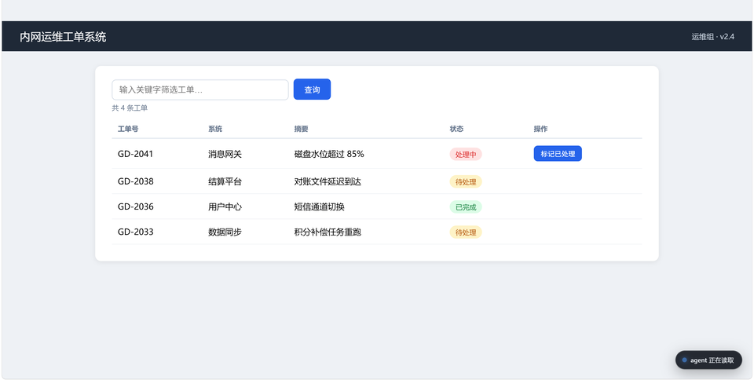
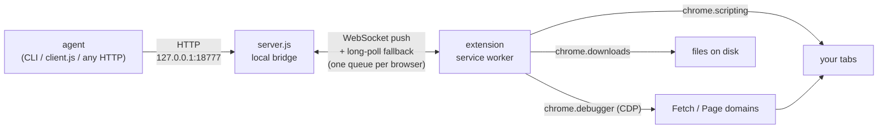
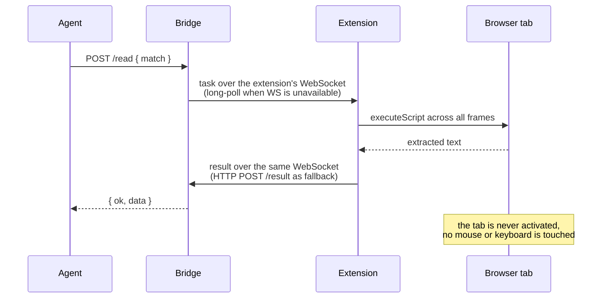
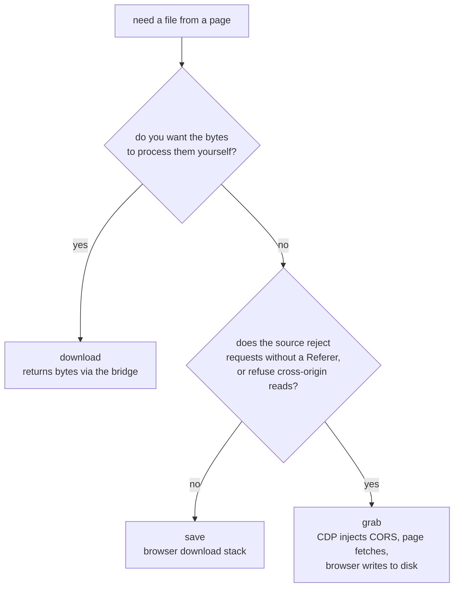

# Agent Browser Bridge

[](https://github.com/hhhwdt/agent-browser-bridge/actions/workflows/ci.yml)

**Let a local agent drive the browser you already have open — in the background, without stealing
focus.**

A browser extension plus a small local server. An agent gets to read pages, click, type, wait, take
screenshots and save files on your real, already-logged-in session, on any tab, **including
background tabs**, while you keep working in another window.

[简体中文](README.zh-CN.md) · English · [Quickstart](docs/QUICKSTART.md)

<p>
  
</p>


---

> **Read this before you install.** Once the bridge is running, any program on this machine that
> can reach its port can act in your browser with your own logged-in session, including while you
> are not watching. [DISCLAIMER.md](docs/DISCLAIMER.md) explains what it can do, what you have to judge
> for yourself, and what it is not for. The threat model and the gaps that are *not* closed are in
> [SECURITY.md](docs/SECURITY.md); what it reads and stores is in [PRIVACY.md](docs/PRIVACY.md).

---

## Contents

- [The problem it solves](#the-problem-it-solves)
- [How it works](#how-it-works)
- [What it can do](#what-it-can-do)
- [Requirements](#requirements)
- [Install](#install)
- [Permissions](#permissions)
- [Use it from an agent (MCP)](#use-it-from-an-agent-mcp)
- [Usage](#usage)
- [Getting files out of a page](#getting-files-out-of-a-page)
- [Finding media on a page](#finding-media-on-a-page)
- [Seeing what the agent is doing](#seeing-what-the-agent-is-doing)
- [Pages that fight back](#pages-that-fight-back)
- [Security model](#security-model)
- [Testing](#testing)
- [Project layout](#project-layout)
- [Limitations](#limitations)
- [Contributing](#contributing)
- [License](#license)
- [Disclaimer](docs/DISCLAIMER.md) · [Security policy](docs/SECURITY.md) · [Privacy](docs/PRIVACY.md)
  · [Changelog](CHANGELOG.md)

---

## The problem it solves

Almost all browser automation starts a **fresh** browser. That means no logins, no cookies, no
extensions, and a window that pops up over whatever you were doing. It falls apart the moment a page
needs SSO — which is most of the pages worth automating.

This project does the opposite. It attaches to the browser that is **already running and already
signed in**, so every page is authenticated before the agent touches it.

It also handles the awkward realities of real sites, which are where naive automation tends to
break: editors that live inside an `iframe`, editors that use `designMode` instead of
`contenteditable`, UI that only mounts when a tab is visible, buttons whose handlers listen for
`mousedown` rather than `click`, tabs the browser has frozen, download links that reject requests
without a `Referer`, and CDNs that refuse cross-origin reads.

## How it works



A command's round trip:



Because work happens through `chrome.scripting.executeScript`, the tab is **never activated**, the
mouse never moves, and no synthetic keystrokes are sent. A background tab works exactly as well as
the one you are looking at — which is the whole point.

## What it can do

| Capability | What it does |
|---|---|
| `read` | Page text; auto-detects the main content region, or a WYSIWYG editor frame |
| `links` | List anchors with index, text and href |
| `click` | Click links, and buttons with **risk-based auto-allowance** |
| `type` | Type into inputs, textareas, `contenteditable` and `designMode` editors |
| `key` | Dispatch key events to in-page handlers |
| `navigate` | Open a URL in a background tab; waits for the navigation to commit |
| `wait` | Wait for an element or text to appear or disappear |
| `eval` | Run JavaScript in the page and return the result |
| `screenshot` | Element, full-page, or background-tab capture |
| `media` | List every media candidate on a page (video, streams, images, audio) |
| `save` | Save a URL to disk through the browser's download stack |
| `grab` | Save media from CDNs that are hotlink-protected *and* refuse CORS |
| `download` | Fetch a URL with the page's login state and hand you the bytes |
| `upload` | Put local files into a file input |
| `session` | Read the tab's cookies and web storage *(opt-in permission)* |
| `tabs` `mark` `unmark` `close` `activate` | Tab management, plus a visible "agent is working here" marker |
| `frames` | Diagnose which frame holds the editor, and how it is editable |
| `diag` | Extension runtime diagnostics: version, WS channel state, restarts, errors |

Chrome and Edge run side by side, fully isolated, with automatic routing.

## Requirements

- Node.js 18+
- Chrome or Edge (Chromium 102+; MV3)

Optional, only for pulling media off sites whose streams are fragmented:

- [`yt-dlp`](https://github.com/yt-dlp/yt-dlp): handles HLS/DASH and a very long list of sites
- `ffmpeg`: merges the fragments `yt-dlp` downloads

The bridge works fine without them; they are for the download use case.

## Install

> `node src/setup.js` walks every step below and reports which one is missing, with the next action for
> it. Re-run it whenever something stops working; it is the fastest way to find out which layer is
> at fault.

**0. What you need**

- Node.js 18 or newer. The bridge has no dependencies; `node src/server.js` is the whole runtime.
- Chrome, Edge, or another Chromium browser.

The extension is loaded from source. There is no extension-store listing: this tool needs the
`debugger` permission, executes code that a local program supplies at run time, and asks for site
access, a combination store review policies treat as remote code execution and remote control.

**1. Start the bridge**

```bash
node src/server.js            # listens on 127.0.0.1:18777 only
```

On Windows there are two helper scripts:

```powershell
powershell -NoProfile -ExecutionPolicy Bypass -File .\scripts\start-server.ps1
powershell -NoProfile -ExecutionPolicy Bypass -File .\scripts\restart-server.ps1   # after editing server.js
```

**1b. Or install it, and drop the path from every command below**

```bash
npm i -g .                     # from a clone: installs the three commands above
npm i -g @hhhwdt/agent-browser-bridge  # the same, once the package is published
```

That gives `agent-browser-bridge` (the bridge), `agent-browser-bridge-setup` (the self-check) and
`agent-browser-bridge-mcp` (the MCP server for the agent). The package carries `extension/` as well,
so the self-check prints the folder to load in step 2; no clone needed on the machine that only
*runs* the bridge.

**2. Load the extension**

- Chrome: `chrome://extensions` → enable **Developer mode** → **Load unpacked** → pick `extension/`
- Edge: `edge://extensions` → enable **Developer mode** → **Load unpacked** → pick `extension/`

**3. Grant site access**

Nothing is authorised by default. Click the extension icon and grant the sites you want it to work
on, one hostname at a time or all sites. The browser's own permission prompt is what enforces
this, so you stay in control.

> **Upgrading from 1.4.x:** the manifest now carries a public key, which fixes the extension ID.
> Your existing install gets a new ID on reload, and site grants are tied to the old one, so they
> have to be granted again. Check `chrome://extensions` (or `edge://extensions`) for a leftover
> entry for the old ID and remove it. To confirm the server and the extension agree, run
> `node src/cli.js diag` and compare `extensionId` with `allowedExtensionIds` in `/health`.

## Permissions

The install prompt stays small on purpose. Two things are worth knowing, because Chrome's own rules
decided them for us:

| Permission | State | Why |
|---|---|---|
| `tabs` `scripting` `storage` `alarms` | required | the core: find tabs, inject, keep the connection alive |
| `debugger` | **required** | powers `upload`, CDP screenshots and `grab`. Chrome **forbids** this one being optional — declaring it optional makes Chrome drop it and the install logs an error, so it has to be required |
| `downloads` | **required** | powers `save` and `grab` |
| `cookies` | **optional** | powers `session`. Requested only when you press the button in the popup; until then `session` returns `permission_not_granted`. Note the scope: once granted it covers cookies on **every** open tab, not only the sites you authorised |
| host access (`*://*/*`) | **optional** | granted per site from the popup, never at install time |

If you would rather not hand over `debugger`, delete `upload`, `screenshot` and `grab`; nothing
else depends on it.

## Use it from an agent (MCP)

The bridge speaks MCP, so any MCP-capable agent (Claude Code, Cursor, Cline, Windsurf) can drive
your browser with one config line, and no code.

From the repository root, let the shell fill in the path; nothing to type, nothing hard-coded:

```bash
claude mcp add -s user browser -- node "$PWD/src/mcp.js"      # macOS, Linux, Git Bash
claude mcp add -s user browser -- node "%CD%\src\mcp.js"      # Windows cmd
```

Or install it globally and use the command name, with no path at all:

```bash
npm i -g .                                                    # provides agent-browser-bridge-mcp
claude mcp add -s user browser -- agent-browser-bridge-mcp
```

Or put it in a project's `.mcp.json`, where the path is relative and the client resolves it:

```json
{
  "mcpServers": {
    "browser": { "command": "node", "args": ["src/mcp.js"] }
  }
}
```

Whichever you pick, `-s user` makes the server available in every project. The client stores a
resolved path at registration time; that is its business, not something this repository hard-codes.

17 tools, all prefixed `browser_`: `list_tabs`, `read_page`, `get_links`, `navigate`, `click`,
`type`, `press_key`, `wait_for`, `screenshot`, `eval`, `frames`, `save_file`, `upload_file`,
`session`, `close_tab`, `clear_marks`, `status`. `node src/mcp.js --list-tools` prints them with the
arguments each one requires.

Three things to know:

- **It starts the bridge for you.** If the port is dead, the first tool call spawns `src/server.js` in
  the background. There is no separate service to remember to start; end that node process when you
  want it gone. If the bridge is up but no extension is connected, you get told that instead.
- **Screenshots come back as images**, not as a data URL, so the model can look at the page. A
  capture too large for a context window is reported with its size and a suggestion to narrow it.
- **The existing rails still apply.** Destructive-looking buttons still need `force`, `type` still
  writes without submitting, and site access is still per-site and denied by default. The escape
  hatches are described as such, with a note to use them only after the user has confirmed the
  specific action.

The server also sends an `instructions` block when an agent connects: list tabs before acting, open
new tabs in the background, close what you opened, clear marks when done, ask before anything
irreversible. That discipline lives with the server rather than in each user's prompt.

None of this removes the install steps above; you still need Node, the bridge and the loaded
extension. What MCP removes is the *integration* step: nobody writes code against `src/client.js`.

## Usage

### CLI

```bash
node src/cli.js tabs
node src/cli.js read  --match "example.com/page"
node src/cli.js links --match "example.com/page"
node src/cli.js click --match "example.com/page" --text "Next page"
node src/cli.js type  --match "example.com/page" --value "hello"
node src/cli.js wait  --match "example.com/page" --selector "#editor"
node src/cli.js navigate --url "https://example.com/other"

# files off a page
node src/cli.js media    --match "example.com/watch"
node src/cli.js save     --url "https://cdn.example.com/pic.jpg" --filename "pic.jpg"
node src/cli.js grab     --match "example.com/watch" --url "<media url>" --filename "clip.mp4"
node src/cli.js download --match "example.com" --url "/export.csv" --out data.csv

# advanced (opt-in permissions apply)
node src/cli.js eval       --match "example.com" --code "document.title"
node src/cli.js screenshot --match "example.com" --out shot.png --selector "table"
node src/cli.js session    --match "example.com" --name SESSION
node src/cli.js upload     --match "example.com" --file /path/to/report.pdf

# bridge management
node src/cli.js token          # show token file path
node src/cli.js token --show   # print the token
node src/cli.js token --rotate # mint a replacement token (prints the steps)
node src/cli.js log            # show last 50 audit log lines
node src/cli.js batch steps.json  # execute a batch of actions
```

`--dryRun` reports what a click *would* hit without clicking, which is useful in automated flows:

```bash
node src/cli.js click --match "example.com" --selector "#btn" --dryRun
# → { isLink, isButtonLike, destructive, blocked }
```

### Client library

Zero dependencies, no CLI needed:

```js
const { createClient } = require('./client.js');

const ab = createClient();                       // 127.0.0.1:18777
if (!(await ab.isReady())) await ab.waitUntilReady(15000);

const page = await ab.read({ match: 'example.com' });
console.log(page.text);

await ab.click({ match: 'example.com', text: 'Next page' });
await ab.wait({ match: 'example.com', selector: '#loaded' });

const media = await ab.media({ match: 'example.com/watch' });
await ab.grab({ match: 'example.com/watch', url: media.videos[0].src, filename: 'clip.mp4' });
```

Failures throw `BridgeError` with a `code`; an unreachable bridge throws `BridgeUnavailableError`.

### New in 1.8.0

**Shared token.** The bridge generates a token on first start. Paste it into the extension popup
once. A second extension cannot read the token file, so it cannot drive the bridge.

**Batch actions.** Execute an ordered list of actions in one call:

```js
await ab.batch([
  { action: 'read', match: 'example.com' },
  { action: 'click', match: 'example.com', selector: '#next' },
  { action: 'wait', match: 'example.com', selector: '#loaded' }
]);
```

**Per-tab lease.** Prevent two agents from operating the same tab simultaneously:

```js
await ab.read({ match: 'example.com', lease: true });
```

**Auto-activate.** Wake a frozen tab and retry automatically:

```js
await ab.read({ match: 'example.com', autoActivate: true });
```

**Markdown output.** Get structured Markdown instead of plain text:

```js
const page = await ab.read({ match: 'example.com', format: 'markdown' });
console.log(page.markdown);
```

**Wait for URL, count, or network idle:**

```js
await ab.wait({ match: 'example.com', url: '/dashboard' });
await ab.wait({ match: 'example.com', selector: '.item', count: 5 });
await ab.wait({ match: 'example.com', idleMs: 2000 });
```

### HTTP

Every capability is a plain endpoint, so any language or tool can drive it. Call `/health` first —
it returns `apiVersion` and `capabilities`, which is the contract for forward compatibility.

```
GET  /health                      status, apiVersion, capabilities, connected browsers
GET  /tabs?browser=edge
POST /read /links /click /type /key /navigate /wait /frames
POST /mark /unmark /activate /close /save /grab /media /download
POST /eval /screenshot /session /upload
POST /reload
```

## Getting files out of a page

Three ways, and they fail in completely different places. Picking the wrong one is the usual reason
a download "doesn't work".



| | `download` | `save` | `grab` |
|---|---|---|---|
| Mechanism | `fetch()` inside the page | `chrome.downloads` | CDP-injected CORS + page `fetch` + blob download |
| Sends the page's `Referer` | yes | **no** | yes |
| CORS applies | **yes** | no | bypassed (header injected) |
| Size limit | 20 MB | none | none |
| Bytes travel | through the bridge (base64) | straight to disk | straight to disk |
| Needs a tab | yes | no | yes (and no DevTools on it) |
| Where it lands | the path you give it | download dir + `videos/` | download dir + `videos/` |

`save` and `grab` deliberately share a destination (`<browser download dir>/videos/`), so media
from either path (and from an external downloader pointed at the same folder) ends up together.

**Why `grab` has to exist.** `Referer` is a forbidden header for XHR/fetch *and* for the
`downloads` API, so a script cannot attach it. `declarativeNetRequest` can set it, but does **not**
apply to extension-initiated downloads; all three of these were verified experimentally, and each
one fails in its own way. So `save` inevitably gets a 403 from a hotlink-protected CDN, and
`download` inevitably gets `Failed to fetch` from CORS. `grab` sidesteps both by letting the *page*
make the request (correct `Referer`, for free) while CDP injects `Access-Control-Allow-Origin` into
the response so the page is allowed to read it.

```bash
# absolute URL
node src/cli.js save --url "https://cdn.example.com/clip.mp4" --filename "clip.mp4"

# relative URL: resolved against the matched tab's own URL
node src/cli.js save --match "example.com/gallery" --url "/media/photo-01.jpg"
```

Both wait for the download to finish and report the real on-disk path. Same-name files are renamed
rather than overwritten unless you pass `--overwrite`. One caveat: Chrome may adjust the extension
to match the server's `Content-Type` (a `.md` served as `text/plain` is saved as `.txt`).

## Finding media on a page

`media` is what makes this usable by an agent without hand-written probes. Point it at a page and it
returns every candidate it can find:

- `<video>` / `<audio>` element sources
- HLS/DASH manifests and direct links scraped from the page's own data
- content-sized images (UI icons are filtered out by rendered dimensions)

`blob:` sources are reported as such rather than hidden, because those are in-memory handles; you
have to locate the underlying stream before anything can be downloaded.

```bash
node src/cli.js media --match "example.com/watch"
# → { videos: [...], streams: [...], images: [...], counts: {...} }
```

Typical flow: `media` finds the URL with the browser's session → `grab` saves it. For fragmented
streams, hand the manifest URL to `yt-dlp` instead and let it download and merge the segments.

## Seeing what the agent is doing

Every tab an agent touches is marked, two ways:

- **A dot on the favicon**: the site's icon is redrawn with a coloured dot composited in, and
  written back to every `<link rel="icon">`. The colour tracks the operation: read, click, type,
  navigate.
- **A prefix on the tab title.**

Both clear themselves after a few minutes (the page schedules its own cleanup, so even a frozen
background tab tidies up when you next visit it), and both can be cleared on demand: from the
extension popup, or with `read.js unmark`.

Inside the page itself, `click` / `type` / `key` also drive a **virtual cursor**: an arrow that
glides to the target element and presses exactly where the synthetic events fire, so you can watch
what the agent is doing (and where it's about to act) instead of trusting the log. It stays at the
last position until the next action or navigation; probe and dry-run never draw it.

Two details that cost real debugging time, in case you touch this code:

- The favicon link's `type` **must** be updated to `image/png` when swapping in a PNG data URL.
  Leaving it as `image/x-icon` makes the browser fail to decode it and silently fall back to the
  original icon; the DOM looks correct while the tab bar shows nothing.
- A page that rewrites `document.title` (dashboards, SPAs) will drop the title mark, leaving a
  half-mark. Cleanup therefore discovers marked tabs by **either** the title prefix or the tab's
  `favIconUrl`, not the title alone.

Beyond the visible marks, the bridge writes every dispatched action to an audit log (`audit.jsonl`),
recording timestamp, action, target, outcome, and duration. The log records action metadata only —
never page content. Read it with `node src/cli.js log`.

## Pages that fight back

Real sites are messier than test pages. These are handled, and each one was added because it broke
something in practice:

| Situation | Handling |
|---|---|
| **WYSIWYG editor in an `iframe`** | injections run across all frames and pick the best result by score (requested selector > editable frame > most text) |
| **Editor using `designMode`** | `designMode` is detected and the frame's body used as the target, since no element carries `contenteditable` |
| **Editor only mounts when visible** | reported honestly; `activate` brings the tab forward to wake it |
| **Buttons bound to `mousedown`** | a full pointer/mouse event sequence is dispatched, not just `.click()` |
| **Frozen background tab** | every injection is wrapped in a timeout, so it fails fast with `tab_unresponsive` instead of hanging the task. The error names the next step: `activate` then retry, or use `--auto-activate` |
| **Site checks `Referer` / blocks CORS** | `grab` (see above) |
| **Chrome and Edge both open** | one queue per browser; the extension rejects tasks addressed elsewhere; unspecified requests try each browser until the tab is found |

## Security model

- Binds to `127.0.0.1` only. No LAN or internet exposure.
- Validates the `Origin` header and rejects any request that carries a non-local one, so a page
  cannot drive the extension through `fetch` or a form post. The limit: requests sent with *no*
  `Origin` header at all (``, `<script>`, prefetch) are accepted, because that is how local
  scripts talk to the bridge, and how the extension itself talks to it. Such a request can neither
  read a response nor post a task result, but it can trigger a `/tabs` dispatch and hold the poll
  slot, which costs the next task its delivery. The WebSocket channel authenticates with the same
  shared token in its first `hello` message (a browser WebSocket cannot carry custom headers), so a
  page cannot register a channel by URL guessing alone.
- Site access is **denied by default**, enforced by the browser's permission system. The install
  manifest requests no host permissions beyond the local bridge.
- The server rejects extension origins whose ID is not on its allowlist, so an extension that has
  not asked for host access to the bridge gets a 403 rather than control of your browser. The
  manifest carries a public key, which is what makes that ID identical across source installs.
- The bridge requires `X-ABB-Token` on every route except `/health`. The extension reads the token
  from `chrome.storage.local` (pasted in the popup once). A second extension cannot read the token
  file, so it cannot drive the bridge. A same-user process can read the token from disk. See
  [SECURITY.md](docs/SECURITY.md) for the trust boundary.
- Privileged capabilities are separated: `cookies` is opt-in and off until granted from the popup;
  `debugger`-backed actions are declared required only because Chrome forbids the alternative.
- Read operations have no side effects. Write operations are risk-classified, and the caller is told
  what was actually clicked or typed.
- No telemetry and no external network calls. The only outbound requests are the ones *you* ask for:
  `download` fetches the URL you pass with the tab's login state, `grab` fetches the media URL you
  pass, `eval` runs the code you pass.
- `type` with `method: 'html'` sanitises its input: strips `script`/`iframe`/`style`, `on*` handlers
  and `javascript:` URLs.
- `grab` injects a permissive CORS header for one CDN origin, for the duration of that single call.
  The interception is scoped to that origin, every other request passes through untouched, and the
  debugger is detached as soon as the call ends.

Because `eval`, `session` and `download` are powerful primitives, treat anything that can reach the
local bridge and read the token file as able to use them once granted. Keep port 18777 on loopback.

What is deliberately *outside* this model (same-user processes, the user themselves) is listed in
[SECURITY.md](docs/SECURITY.md). Do not read the summary above as a stronger claim than the one written there.

## Testing

Two entry points need no configuration at all.

**Offline**: no browser, no test page, and no interference with a bridge you already have running.
Each suite starts its own bridge on a throwaway port, or drives the extension's injected functions
against a stand-in DOM.

```bash
node test/test-offline.js        # all of the suites below, then a summary
```

| Suite | What it pins down |
|---|---|
| `test-server.js` | dispatch, the task queue (including that an expired task is *not* executed later), result-body size, origin checks |
| `test-eval.js` | `eval` runs your code exactly once — assessed against a real extraction of `evalInPage` |
| `test-frame-targeting.js` | click/type/key act in one frame, not in every frame that contains a match |
| `test-client.js` | repeated CLI arguments accumulate; a timeout is not reported as "service not started" |
| `test-allowlist.js` | which origins may drive the bridge, and that the manifest key derives the allowlisted ID |
| `test-sw-load.js` | the service-worker module graph loads at all, boots exactly once, and still exports what it used to — in a browser a load-time failure only shows up as "the extension stopped responding" |
| `test-result-semantics.js` | an action that could not do its job reports `ok: false` rather than success — the failure mode that leaves the caller with no reason to look again |
| `test-i18n-keys.js` | every i18n key used by the popup and the manifest exists in both locale files — a missing key renders as an empty string, which is silent |
| `test-wait.js` | each wait condition (selector, text, url, count, idle) returns ok when satisfied and `wait_timeout` when not — the failure mode that means "the next step ran before the page was ready" |
| `test-audit.js` | the audit log records actions but never page content — a log that leaks what someone read is worse than no log |
| `check-inject-scope.js` | an injected function only carries its own source, so referencing a module-level helper compiles and then throws at runtime |
| `check-extension-id.js` | the ID claim above, on its own — drift here has no visible symptom |
| `check-version.js` | `package.json` and the manifest carry the same version, so `diag` and the registry cannot disagree about what is installed |
| `check-package.js` | nothing untracked reaches the npm tarball; `npm pack` includes `README*` regardless of `.gitignore`, which is how a local ops document almost shipped |
| `test-mcp.js` | the MCP protocol, spoken directly rather than through an SDK |
| `test-token.js` | token is generated, required, and validated — the failure mode where a missing token lets any local program drive the bridge |
| `test-update.js` | version comparison logic — the failure mode where a user sees a wrong update prompt or no prompt when one is needed |
| `test-markdown.js` | HTML to Markdown conversion — the failure mode where structure is lost or page content is dumped raw |
| `test-frozen-tab.js` | the hint names the next step — the failure mode where a user doesn't know to activate before retrying |
| `test-batch.js` | batch execution order and stop-on-failure — the failure mode where a batch bypasses the risk rails or runs steps out of order |
| `test-lease.js` | lease acquisition and release — the failure mode where two agents interleave on the same tab with no ordering guarantee |

`test-mcp.js` skips its live section when `ABB_MCP_OFFLINE=1` is set, which is what CI uses. The same
suite runs on Linux (Node 18/20/22) and on Windows (Node 18/22). Windows is this tool's main
platform, so it is not left to a single Ubuntu job to prove.

`test/` and `tools/` exist in a clone only; they are not part of the published package.

**Live**: a real browser, still no configuration. It uses the bridge's own address as the page under
test, which the manifest already permits, so there is no site to grant:

```bash
node test/test-live.js           # 17 assertions
```

It opens a background tab, injects a fixture, and checks the things that fail *silently* when they
fail: that a click landing in two frames happens once, that a `type` inserts once, that an `eval`
without a `return` runs once, and that a 2 MB download survives the trip back through the bridge. It
clears its own mark and closes its tab on the way out.

```bash
node test/test-cli.js            # 22 assertions, one per subcommand
```

Same idea, one layer up: it opens one background tab and runs every CLI subcommand against it,
asserting each still prints what it is supposed to. That is how a long-standing bug surfaced:
`click --dryRun` had been reading a field the dry run does not return, so only the human-readable
output was broken while `--json` looked fine.

**Configured** (needs a page you control):

```bash
cp test/test-config.example.js test/test-config.js   # then edit it

node test/test-basic.js          # 33 assertions: reads, writes, routing, errors
node test/test-multibrowser.js   # 12 assertions: Chrome/Edge isolation (needs both)
node test/test-interaction.js    # 10 assertions: click classification + wait (dry-run only)
node test/test-editor.js         # WYSIWYG editor path (enters edit mode; creates a draft)
```

They create and close their own tabs and leave your active tab untouched.

> `test-editor.js` enters the page's edit mode, which makes the site auto-save a draft. Point it at
> a scratch page, not production content.

## Project layout

```
src/                     the Node side
  server.js              the local bridge — implementation in src/server/
  client.js              client library (`main` in package.json), for calling the bridge yourself
  cli.js                 the same capabilities from the command line — implementation in src/cli/
  mcp.js                 the MCP server your agent talks to — implementation in src/mcp/
  setup.js               one-command self-check: which layer is missing, what to do about it
extension/               the browser extension (MV3)
  manifest.json          permissions, entry point, public key
  popup.html/.js         status, site grants, opt-in permissions, clear marks
  sw/                    the service worker, split by responsibility
    background.js        task dispatch, poll fallback, boot, listeners
    ws.js                WebSocket task channel (push while connected, poll takes over on drop)
    actions.js           one function per action, grouped into actions-*.js files
    inject-*.js          the functions that get serialised into a page
    marks.js             the visible "an agent touched this tab" state
    guards.js            injection timeouts, frame choice, permission checks
    config.js            bridge URL, poll timings, browser identity
test/                    tests — see Testing above for which ones need a browser
  config.js              test-page configuration loader (test-config.js is yours, git-ignored)
tools/                   offline checks: injected-function scope, extension-ID consistency
scripts/                 Windows helpers for running the bridge as a service
docs/                    disclaimer, security model, privacy, quickstart, architecture
```

Only `README*`, `LICENSE` and `package.json` sit at the top level; everything executable is in a
directory named for what it is. `src/cli.js` and `src/mcp.js` are also declared as npm `bin` entries,
so an installed copy is reached as `agent-browser-bridge` / `agent-browser-bridge-mcp` instead of by
path.

Two things to know before you touch the code:

- The extension's service worker is the only part that touches a page, and its
  `sw/inject-*.js` modules are special: those functions are serialised into the page, so each one has
  to be self-contained. `tools/check-inject-scope.js` enforces that, and `docs/ARCHITECTURE.md`
  explains why it matters.
- The bridge handles every HTTP route through a table in `src/server/index.js`, one small
  function per route. Adding an endpoint means adding a line there.

## Limitations

- The browser must be running with the extension enabled.
- A page must have been loaded at least once; never-rendered content cannot be read.
- `key` dispatches synthetic events: they trigger in-page handlers but do not produce text and
  cannot trigger browser-level shortcuts. Use `type` for text.
- Editing UIs that only mount when the tab is visible need the tab foregrounded once.
- **Streams whose source is a `blob:` URL cannot be saved directly.** Those are in-memory handles,
  not fetchable addresses. If the page builds them from a manifest, `media` will usually surface
  that manifest, and the manifest can be downloaded instead.
- **DRM-protected content is out of scope.** Decryption keys for those live behind a licence server
  and hardware secure path; obtaining them means defeating the protection itself, which this project
  does not do.
- Not affiliated with any browser vendor; uses only documented extension APIs.
- The shared token protects against other extensions, but a local process running as the same user
  can read the token file from disk. Do not run the bridge on a shared or compromised machine.
- Batch actions are not transactional: if step 3 fails, steps 1-2 are already committed. Use
  `continueOnError: true` only when later steps do not depend on earlier ones.
- Per-tab leases expire after 5 minutes. A crashed caller's lease will block others until it expires.

## Contributing

Bug reports, translations and pull requests are welcome. See [CONTRIBUTING.md](CONTRIBUTING.md) for
how to run the tests, the rules this codebase holds itself to, and the one deadlock worth knowing
about before you reload the extension. Changes are recorded in [CHANGELOG.md](CHANGELOG.md).

Report vulnerabilities privately, not in a public issue: [SECURITY.md](docs/SECURITY.md).

## License

MIT; see [LICENSE](LICENSE).
