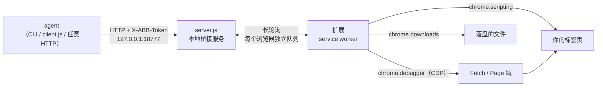
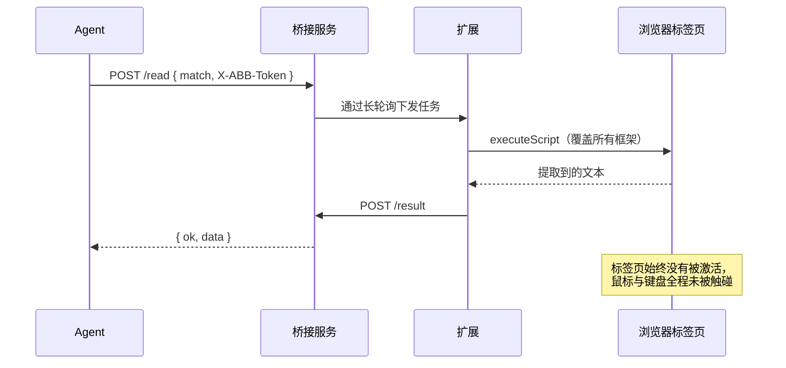
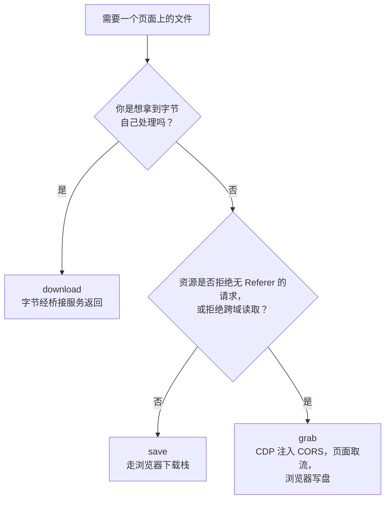

# Agent Browser Bridge

[](https://github.com/hhhwdt/agent-browser-bridge/actions/workflows/ci.yml)

**让本机 AI agent 操控你已经打开的那个浏览器 —— 完全后台运行，不抢焦点。**

一个浏览器扩展加一个本地小服务。agent 能读页面、点击、输入、等待、截图、存文件，用的都是你
**真实且已登录**的会话；任意标签页都能操作，**包括后台标签页**，而你可以在别的窗口照常干活。

简体中文 · [English](README.md) · [快速开始](docs/QUICKSTART.zh-CN.md)

---

> **装之前先读这一段。** 桥接服务一旦跑起来，本机上任何能访问它端口并能读取 token 文件的程序，
> 都能用**你自己的登录态**在浏览器里操作，包括你没在看着的时候。[免责声明与使用须知](docs/DISCLAIMER.zh-CN.md) 写清了它
> 能做什么、哪些判断必须你自己做、以及它不是用来干什么的。威胁模型和**尚未封堵**的缺口在
> [SECURITY.md](docs/SECURITY.md)，读取与存储了什么在 [PRIVACY.md](docs/PRIVACY.md)。

---

## 目录

- [它解决什么问题](#它解决什么问题)
- [工作原理](#工作原理)
- [能做什么](#能做什么)
- [环境要求](#环境要求)
- [安装](#安装)
- [权限模型](#权限模型)
- [给 agent 用（MCP）](#给-agent-用mcp)
- [用法](#用法)
- [1.8.0 新功能](#180-新功能)
- [把文件从页面里取出来](#把文件从页面里取出来)
- [发现页面里的媒体](#发现页面里的媒体)
- [看到 agent 正在做什么](#看到-agent-正在做什么)
- [难缠的页面](#难缠的页面)
- [安全模型](#安全模型)
- [测试](#测试)
- [项目结构](#项目结构)
- [已知限制](#已知限制)
- [参与开发](#参与开发)
- [许可](#许可)
- [免责声明](docs/DISCLAIMER.zh-CN.md) · [安全政策](docs/SECURITY.md) · [隐私说明](docs/PRIVACY.md)
  · [变更记录](CHANGELOG.md)

---

## 它解决什么问题

几乎所有浏览器自动化都是**新开一个浏览器**：没有登录态、没有 Cookie、没有扩展，还会弹出一个
窗口盖住你正在做的事。一旦页面需要 SSO 就彻底失效 —— 而值得自动化的页面大多都需要 SSO。

这个项目反着来：它挂到**已经在运行、已经登录**的浏览器上，所以 agent 动手之前，每个页面就已经
是登录态。

它也处理真实网站的麻烦之处 —— 这些正是朴素自动化最容易翻车的地方：编辑器藏在 `iframe` 里、
编辑器用 `designMode` 而不是 `contenteditable`、UI 只在标签页可见时才渲染、按钮监听的是
`mousedown` 而不是 `click`、标签页被浏览器冻结、下载链接拒绝没有 `Referer` 的请求、
CDN 拒绝跨域读取。

## 工作原理



一条指令的完整往返：



因为一切通过 `chrome.scripting.executeScript` 完成，标签页**永远不会被激活**，鼠标不会移动，
也不会发送任何模拟按键。后台标签页和你正在看的那个一样好用 —— 这正是关键所在。

## 能做什么

| 能力 | 说明 |
|---|---|
| `read` | 读取正文；自动识别主内容区，或富文本编辑器所在的框架 |
| `links` | 列出链接（含序号、文字、地址） |
| `click` | 点击链接，以及带**风险分级**的按钮 |
| `type` | 写入输入框、文本域、`contenteditable` 与 `designMode` 编辑器 |
| `key` | 向页面内处理器派发按键事件 |
| `navigate` | 在后台标签页打开地址；等待导航真正提交 |
| `wait` | 等待元素/文字出现消失、URL 包含子串、元素数量达标、网络空闲 |
| `eval` | 在页面里执行 JavaScript 并取回结果 |
| `screenshot` | 元素、整页或后台标签页截图 |
| `media` | 列出页面里所有媒体候选（视频、流清单、图片、音频） |
| `save` | 走浏览器下载栈把地址保存到磁盘 |
| `grab` | 保存那些「有防盗链 **且** 拒绝跨域」的 CDN 上的媒体 |
| `download` | 带页面登录态取回地址内容，把字节交给你 |
| `upload` | 把本地文件填进文件选择框 |
| `session` | 读取标签页的 Cookie 与站点存储（**可选权限**） |
| `tabs` `mark` `unmark` `close` `activate` | 标签页管理，以及「agent 正在操作」的可见标记 |
| `frames` | 诊断编辑器在哪个框架、以何种方式可编辑 |
| `diag` | 扩展运行诊断：版本、轮询、重启次数、错误日志 |
| `batch` | 批量执行多个动作，按顺序执行，每步独立返回结果 |
| `read --format markdown` | 获取结构化 Markdown 而非纯文本 |
| `read --auto-activate` | 自动唤醒冻结标签页并重试 |
| `read --lease` | 获取标签页独占锁，防止两个 agent 同时操作 |

Chrome 与 Edge 可同时使用，彼此完全隔离，且自动选路。

## 环境要求

- Node.js 18+
- Chrome 或 Edge（Chromium 102+；MV3）

以下可选，仅在需要下载分片流媒体时使用：

- [`yt-dlp`](https://github.com/yt-dlp/yt-dlp) —— 处理 HLS/DASH，支持站点极多
- `ffmpeg` —— 合并 `yt-dlp` 下载的分片

不用它们，桥接服务本身照常工作。

## 安装

> `node src/setup.js` 会把下面每一步都查一遍，告诉你缺的是哪一步、下一步该做什么。
> 出问题时先跑它——定位到具体哪一层最快的方式。

**0. 需要什么**

- Node.js 18 或更高版本。桥接服务没有第三方依赖，`node src/server.js` 就是全部运行环境。
- Chrome、Edge 或其他 Chromium 内核浏览器。

扩展从源码加载，没有商店版本。它需要 `debugger` 权限、会执行本机程序在运行时传入的代码、
还要求站点访问权限——这几条放在一起，会被商店审核判为远程代码执行与远程控制。

**1. 启动桥接服务**

```bash
node src/server.js            # 只监听 127.0.0.1:18777
```

Windows 下有两个辅助脚本：

```powershell
powershell -NoProfile -ExecutionPolicy Bypass -File .\scripts\start-server.ps1
powershell -NoProfile -ExecutionPolicy Bypass -File .\scripts\restart-server.ps1   # 改完 server.js 后重启
```

**1b. 或者装成包，后面每条命令都不用再写路径**

```bash
npm i -g .                     # 从克隆目录装：装上下面三个命令
npm i -g agent-browser-bridge  # 包发布之后，从 registry 装是同一个效果
```

装上之后有 `agent-browser-bridge`（桥接）、`agent-browser-bridge-setup`（自检）、
`agent-browser-bridge-mcp`（给 agent 用的 MCP 服务）。包里同时带着 `extension/`，第 2 步要选的
目录由自检命令直接打印出来 —— 只负责**运行**桥接的机器不需要克隆仓库。

**2. 加载扩展**

- Chrome：`chrome://extensions` → 开启**开发人员模式** → **加载已解压的扩展程序** → 选 `extension/`
- Edge：`edge://extensions` → 开启**开发人员模式** → **加载解压缩的扩展** → 选 `extension/`

**3. 授予站点权限**

默认不授权任何站点。点扩展图标，逐个授权你要它操作的站点，或一次性授权全部。权限由浏览器
自身的提示框确认，控制权在你手上。

> **从 1.4.x 升级：** 清单里现在带了一个公钥，扩展 ID 因此被固定。你现有的安装重载后会换成新
> ID，而站点授权是绑在旧 ID 上的，需要重新授权一遍。到 `chrome://extensions`（或
> `edge://extensions`）检查有没有旧 ID 的残留条目，有就删掉。想确认服务端和扩展对得上，跑
> `node src/cli.js diag` 看 `extensionId`，与 `/health` 里的 `allowedExtensionIds` 比对。

**3b. 粘贴桥接 token**

桥接服务首次启动时会生成 token。扩展需要它来证明身份。

1. 找到 token 文件（桥接服务启动时会打印路径）：
   - Windows：`%APPDATA%\agent-browser-bridge\token`
   - macOS/Linux：`~/.config/agent-browser-bridge/token`
2. 复制 token（64 位十六进制字符串）。
3. 粘贴到扩展弹窗的"桥接 token"输入框，点**保存 token**。

或者运行 `node src/cli.js token --show` 打印 token。

## 权限模型

安装时的索取刻意保持最小。有两件事值得说明 —— 它们是 Chrome 的规则决定的，不是我们的选择：

| 权限 | 状态 | 用途与原因 |
|---|---|---|
| `tabs` `scripting` `storage` `alarms` | 必需 | 核心能力：找标签页、注入脚本、维持连接 |
| `debugger` | **必需** | 支撑 `upload`、CDP 截图与 `grab`。Chrome **禁止**它作为可选权限 —— 写成可选会被直接丢弃并在扩展页报错，所以只能是必需 |
| `downloads` | **必需** | 支撑 `save` 与 `grab` |
| `cookies` | **可选** | 支撑 `session`。只有你在弹窗里点「授予」才会申请；在此之前 `session` 返回 `permission_not_granted`。注意范围：授予后对**所有**已打开标签页的 Cookie 生效，不止你授权过的站点 |
| 站点访问（`*://*/*`） | **可选** | 由弹窗逐站授予，安装时绝不索取 |

桥接服务还会在配置目录生成一个 token 文件（`%APPDATA%\agent-browser-bridge\token` 或
`~/.config/agent-browser-bridge/token`），扩展凭此证明身份。其他扩展无法读取该文件。

如果你不想把 `debugger` 交出去，删掉 `upload`、`screenshot`、`grab` 三个动作即可 —— 其他功能
不依赖它。

## 给 agent 用（MCP）

桥接会说 MCP，所以任何支持 MCP 的 agent（Claude Code、Cursor、Cline、Windsurf）配一行就能用，
不用写代码。

在仓库根目录执行，路径交给 shell 填——不用手打，也不用写死：

```bash
claude mcp add -s user browser -- node "$PWD/src/mcp.js"      # macOS / Linux / Git Bash
claude mcp add -s user browser -- node "%CD%\src\mcp.js"      # Windows cmd
```

或者全局装一次，直接用命令名，完全不涉及路径：

```bash
npm i -g .                                                    # 提供 agent-browser-bridge-mcp
claude mcp add -s user browser -- agent-browser-bridge-mcp
```

也可以写进项目的 `.mcp.json`，路径是相对的，由客户端解析：

```json
{
  "mcpServers": {
    "browser": { "command": "node", "args": ["src/mcp.js"] }
  }
}
```

三种都行；`-s user` 表示所有项目里都能用。客户端会在注册那一刻把路径解析成实际值存起来——那是它的
事，仓库里不写死任何路径。

共 17 个工具，统一 `browser_` 前缀：`list_tabs`、`read_page`、`get_links`、`navigate`、`click`、
`type`、`press_key`、`wait_for`、`screenshot`、`eval`、`frames`、`save_file`、`upload_file`、
`session`、`close_tab`、`clear_marks`、`status`。`node src/mcp.js --list-tools` 会打印完整清单和各自的
必填参数。

三点需要知道：

- **它会把桥接服务拉起来。** 端口上没服务时，第一次工具调用会在后台启动 `src/server.js`，不用你记得
  先起服务。不想要了就结束那个 node 进程。服务在跑但扩展没连上时，会明确告诉你是这个原因。
- **截图以图片形式返回**，不是 data URL，模型能直接看到页面。体积超出上下文承受范围的截图只回报
  尺寸和"请改用 selector 收窄"的提示。
- **原有的安全约束全部保留。** 破坏性文案的按钮仍然需要 `force`，`type` 仍然只写内容不提交，站点
  授权仍然是逐站、默认拒绝。这些"后门"参数的说明里写清了什么时候不该用。

agent 连接时服务还会下发一段 `instructions`：先列标签页再动手、新页面开在后台、自己开的自己关、
收尾清标记、不可逆动作先问。这套纪律跟着服务走，不依赖每个用户的提示词。

MCP 不能省掉上面的安装步骤——Node、桥接服务、加载扩展一样都要。它省掉的是**对接**这一步：
没人需要再对着 `src/client.js` 写代码。

## 用法

### 命令行

```bash
node src/cli.js tabs
node src/cli.js read  --match "example.com/page"
node src/cli.js links --match "example.com/page"
node src/cli.js click --match "example.com/page" --text "下一页"
node src/cli.js type  --match "example.com/page" --value "hello"
node src/cli.js wait  --match "example.com/page" --selector "#editor"
node src/cli.js navigate --url "https://example.com/other"

# 从页面取文件
node src/cli.js media    --match "example.com/watch"
node src/cli.js save     --url "https://cdn.example.com/pic.jpg" --filename "pic.jpg"
node src/cli.js grab     --match "example.com/watch" --url "<媒体地址>" --filename "clip.mp4"
node src/cli.js download --match "example.com" --url "/export.csv" --out data.csv

# 高级能力（适用前述可选权限）
node src/cli.js eval       --match "example.com" --code "document.title"
node src/cli.js screenshot --match "example.com" --out shot.png --selector "table"
node src/cli.js session    --match "example.com" --name SESSION
node src/cli.js upload     --match "example.com" --file /path/to/report.pdf

# 桥接管理
node src/cli.js token          # 显示 token 文件路径
node src/cli.js token --show   # 打印 token
node src/cli.js log            # 显示最近 50 条审计日志
node src/cli.js batch steps.json  # 批量执行动作
```

`--dryRun` 只回报「点击会命中什么」而不真的点，适合自动化流程里先探测：

```bash
node src/cli.js click --match "example.com" --selector "#btn" --dryRun
# → { isLink, isButtonLike, destructive, blocked }
```

### 客户端库

零依赖，不必经过命令行：

```js
const { createClient } = require('./client.js');

const ab = createClient();                       // 127.0.0.1:18777
if (!(await ab.isReady())) await ab.waitUntilReady(15000);

const page = await ab.read({ match: 'example.com' });
console.log(page.text);

await ab.click({ match: 'example.com', text: '下一页' });
await ab.wait({ match: 'example.com', selector: '#loaded' });

const media = await ab.media({ match: 'example.com/watch' });
await ab.grab({ match: 'example.com/watch', url: media.videos[0].src, filename: 'clip.mp4' });
```

失败时抛出 `BridgeError`，用 `err.code` 判断原因；服务未启动则抛 `BridgeUnavailableError`。

### 1.8.0 新功能

**共享 token。** 桥接服务首次启动时生成 token，在扩展弹窗里粘贴一次。其他扩展无法读取 token 文件，无法驱动桥接。

**批量动作。** 一次调用执行多个动作：

```js
await ab.batch([
  { action: 'read', match: 'example.com' },
  { action: 'click', match: 'example.com', selector: '#next' },
  { action: 'wait', match: 'example.com', selector: '#loaded' }
]);
```

**Per-tab lease。** 防止两个 agent 同时操作同一标签页：

```js
await ab.read({ match: 'example.com', lease: true });
```

**Auto-activate。** 自动唤醒冻结标签页并重试：

```js
await ab.read({ match: 'example.com', autoActivate: true });
```

**Markdown 输出。** 获取结构化 Markdown 而非纯文本：

```js
const page = await ab.read({ match: 'example.com', format: 'markdown' });
console.log(page.markdown);
```

**等待 URL、元素数量或网络空闲：**

```js
await ab.wait({ match: 'example.com', url: '/dashboard' });
await ab.wait({ match: 'example.com', selector: '.item', count: 5 });
await ab.wait({ match: 'example.com', idleMs: 2000 });
```

### HTTP 接口

每个能力都是普通接口，任何语言或工具都能驱动。建议先读 `/health` —— 它返回 `apiVersion` 与
`capabilities`，这是向前兼容的契约。

```
GET  /health                      状态、apiVersion、能力清单、在线浏览器
GET  /tabs?browser=edge
POST /read /links /click /type /key /navigate /wait /frames
POST /mark /unmark /activate /close /save /grab /media /download
POST /eval /screenshot /session /upload
POST /reload
```

## 把文件从页面里取出来

三种方式，失败的地方完全不同。选错方式，是「下载不好使」最常见的原因。



| | `download` | `save` | `grab` |
|---|---|---|---|
| 机制 | 页面内 `fetch()` | `chrome.downloads` | CDP 注入 CORS + 页面 `fetch` + blob 下载 |
| 是否带页面 `Referer` | 带 | **不带** | 带 |
| 是否受 CORS 限制 | **受限** | 不受 | 绕过（注入响应头） |
| 大小上限 | 20 MB | 无 | 无 |
| 字节传输方式 | 经桥接服务（base64） | 直接写盘 | 直接写盘 |
| 是否需要标签页 | 需要 | 不需要 | 需要（且该页不能开着 DevTools） |
| 落盘位置 | 你指定的路径 | 下载目录 + `videos/` | 下载目录 + `videos/` |

`save` 与 `grab` 刻意共用同一个目录（`<浏览器下载目录>/videos/`），这样两条路的媒体 —— 以及
把输出指到同一目录的外部下载器 —— 最终都汇合在一起。

**为什么必须有 `grab`。** `Referer` 在 XHR/fetch **和** `downloads` API 里都是禁用头，脚本加不上；
`declarativeNetRequest` 能设置它，但**对扩展发起的下载不生效** —— 这三条都经过实测验证，且各自
以不同方式失败。结果就是：`save` 撞上有防盗链的 CDN 必然 403，`download` 撞上 CORS 必然
`Failed to fetch`。`grab` 同时绕开两者：让**页面**去发请求（Referer 天然正确），同时用 CDP 往响应里
注入 `Access-Control-Allow-Origin`，让页面有权读取。

```bash
# 绝对地址
node src/cli.js save --url "https://cdn.example.com/clip.mp4" --filename "clip.mp4"

# 相对地址 —— 按匹配到的标签页自身地址解析
node src/cli.js save --match "example.com/gallery" --url "/media/photo-01.jpg"
```

两者都会等下载真正完成并回报实际落盘路径。同名文件默认自动改名，除非显式传 `--overwrite`。
一个注意点：Chrome 可能按服务器返回的 `Content-Type` 调整扩展名（`.md` 被当作 `text/plain`
返回时会存成 `.txt`）。

## 发现页面里的媒体

`media` 让 agent 不必再手写探测脚本。给它一个页面，它列出所有能找的候选：

- `<video>` / `<audio>` 的媒体源
- 从页面自身数据里挖出的 HLS/DASH 清单与直链
- 内容图片（UI 图标按渲染尺寸过滤掉）

`blob:` 源会被明确标出而不是隐藏 —— 那是内存句柄，必须先把背后的流找到才能下载。

```bash
node src/cli.js media --match "example.com/watch"
# → { videos: [...], streams: [...], images: [...], counts: {...} }
```

典型流程：`media` 用浏览器的登录态找到地址 → `grab` 保存。分片流则把清单地址交给 `yt-dlp`，
由它下载并合并。

## 看到 agent 正在做什么

agent 碰过的每个标签页都会被打标记，两种形式：

- **图标上的圆点** —— 把站点图标重绘并叠一个彩色圆点，写回所有 `<link rel="icon">`。
  颜色对应操作类型：读取、点击、输入、导航。
- **标题前缀**。

两者都会在几分钟后自动清除（页面自己排的清理定时器，所以即便是被冻结的后台标签页，你下次
打开它时也会自动收拾干净），也可以随时手动清除 —— 扩展弹窗里，或 `read.js unmark`。

页面内部，`click` / `type` / `key` 还会驱动一个**虚拟光标**：箭头滑到目标元素上，在合成事件
派发的位置按下，你可以直接看到 agent 在哪操作、下一步要点哪，而不是只信日志。光标驻留在最后
一次操作的位置，直到下一个动作或页面跳转；探测和 dry-run 不会画它。

两个曾让人查了很久的细节，写在这里以防你改到这块代码：

- 换上 PNG data URL 时，图标 link 的 `type` **必须**一并改成 `image/png`。留着 `image/x-icon`
  会让浏览器解码失败并静默回退到原图标 —— DOM 看着是对的，标签栏却什么都不显示。
- 会自己改写 `document.title` 的页面（仪表盘、SPA）会把标题标记冲掉，只剩半截标记。因此清理
  逻辑同时按标题前缀**和**标签页的 `favIconUrl` 来发现标记，而不是只看标题。

除了可见标记，桥接服务还会把每个动作写入审计日志（`audit.jsonl`），记录时间、动作、目标、结果和耗时。
日志只记动作元数据，绝不记页面内容。用 `node src/cli.js log` 查看。

## 难缠的页面

真实网站比测试页乱得多。以下情况都已处理，每一条都是因为实践中出了问题才加的：

| 情况 | 处理方式 |
|---|---|
| **富文本编辑器在 `iframe` 里** | 注入覆盖全部框架，再按评分挑选（指定选择器 > 可编辑框架 > 正文最长） |
| **编辑器用 `designMode`** | 识别 `designMode` 并用该框架的 body 作为目标，因为没有元素带 `contenteditable` |
| **编辑器只在页面可见时渲染** | 如实报告；用 `activate` 把标签页切到前台唤醒它 |
| **按钮绑定在 `mousedown` 上** | 派发完整的指针/鼠标事件序列，而不是只调 `.click()` |
| **冻结的后台标签页** | 每次注入都带超时，快速失败为 `tab_unresponsive`，而不是把任务挂死。报错会指明下一步：先 `activate` 再重试，或用 `--auto-activate` 自动唤醒 |
| **站点校验 `Referer` / 拒绝 CORS** | 用 `grab`（见上） |
| **Chrome 与 Edge 同时打开** | 每个浏览器独立队列；扩展会拒收不是发给自己的任务；未指定浏览器时逐个尝试直到找到标签页 |

## 安全模型

- 只绑定 `127.0.0.1`，不对局域网或外网暴露。
- 校验 `Origin` 请求头，带非本机 Origin 的请求一律拒绝，网页无法用 `fetch` 或表单提交驱动扩展。
  边界到这里为止：完全不带 `Origin` 头的请求（``、`<script>`、预取）会被放行，因为本机脚本
  ——以及扩展自己——就是这样访问的。这类请求既读不到响应、也提交不了任务结果，但能触发一次
  `/tabs` 派发，也能占住轮询槽位，代价是下一个任务投递不出去。
- 站点访问**默认拒绝**，由浏览器权限系统强制。安装清单除本机桥接地址外不索取任何主机权限。
- 服务端拒绝不在允许列表里的扩展 ID，因此一个**没有**申请访问桥接地址的扩展只会拿到 403，
  而不是浏览器控制权。清单里带公钥，正是为了让这个 ID 在所有源码安装之间保持一致。
- 桥接服务要求 `X-ABB-Token` 请求头，扩展从 `chrome.storage.local` 读取 token（在弹窗里粘贴一次）。
  其他扩展无法读取 token 文件，无法驱动桥接。但同用户进程能从磁盘读取 token 文件。
  见 [SECURITY.md](docs/SECURITY.md)。
- 高权限能力被拆开：`cookies` 是可选的，未在弹窗中授予前一律关闭；依赖 `debugger` 的动作之所以
  声明为必需，只是因为 Chrome 不允许另一种写法。
- 读操作没有副作用。写操作按风险分级，并把实际点击/输入的内容回报给调用方。
- 无遥测、无外部网络请求。所有对外请求都是**你要求发起的**：`download` 用标签页登录态取你给的
  地址，`grab` 取你给的媒体地址，`eval` 执行你给的代码。
- `type` 的 `method: 'html'` 会清洗输入：移除 `script`/`iframe`/`style`、剥离 `on*` 事件属性与
  `javascript:` 协议。
- `grab` 只在那一次调用期间、只针对那一个 CDN origin 注入宽松的 CORS 头。拦截范围限定在该
  origin，其余请求原样放行，调用结束立刻卸载调试器。

由于 `eval`、`session`、`download` 都是很强的原语，**任何能访问本机桥接服务并能读取 token 文件的进程**在授权后都能
使用它们。请确保 18777 端口只留在回环地址上。

这个模型**没有**覆盖的部分（同用户进程、以及使用者本人）逐条列在
[SECURITY.md](docs/SECURITY.md)。不要把上面这段总结读成比那份文件更强的承诺。

## 测试

两个入口都不需要任何配置。

**离线**：不用浏览器、不用测试页，也不会干扰你正在跑的那个桥接实例——每个套件各自在临时端口上
起自己的服务，或者在替身 DOM 上驱动扩展的注入函数。

```bash
node test/test-offline.js        # 跑下面全部套件，最后给汇总
```

| 套件 | 钉住的是什么 |
|---|---|
| `test-server.js` | 派发、任务队列（含"已过期的任务不会被事后执行"）、结果体上限、来源校验 |
| `test-eval.js` | `eval` 的代码只执行一次——验证对象是从 `evalInPage` 里抽出来的真实源码 |
| `test-frame-targeting.js` | click/type/key 只在一个框架里执行，不是每个命中的框架都执行一次 |
| `test-client.js` | 重复的命令行参数会累加；超时不会被报成"服务未启动" |
| `test-allowlist.js` | 哪些来源能驱动桥接，以及清单公钥推导出的 ID 与服务端常量一致 |
| `test-sw-load.js` | 服务脚本的模块图能不能加载、启动是不是只发生一次、导出有没有少——在浏览器里加载失败只表现为"扩展没反应" |
| `test-result-semantics.js` | 动作没做成时必须报失败，而不是报成功——这是让调用方"再也不用看第二眼"的那类缺陷 |
| `check-inject-scope.js` | 注入函数只带自身源码：引用模块级辅助函数能编译、却在运行时报错 |
| `check-extension-id.js` | 上面那条 ID 一致性单独跑一遍——这里对不上不会有任何可见症状 |
| `check-version.js` | `package.json` 与清单里的版本号一致，免得 `diag` 报的版本和 registry 上的对不上 |
| `check-package.js` | 发布包里不能有未纳入版本控制的文件；`npm pack` 会强制带上 `README*`，本机运维文档差点就这样被传上去 |
| `test-mcp.js` | MCP 协议本身，自己充当客户端对话，而不是引入 SDK |
| `test-i18n-keys.js` | 弹窗 i18n key 与 locale 文件一致——缺 key 时 `getMessage` 返回空字符串，表现为一片空白 |
| `test-wait.js` | 每种等待条件（selector、text、url、count、idle）成立时返回 ok，不成立时返回 wait_timeout |
| `test-audit.js` | 审计日志记录动作但不泄露页面内容——泄露"谁读了什么"的日志比没有日志更糟 |
| `test-token.js` | 共享 token 的生成、校验、拒绝——没有 token 时任何本机程序都能驱动桥接 |
| `test-update.js` | 版本比较逻辑——用户看到错误的更新提示，或该提示时没提示 |
| `test-markdown.js` | HTML 转 Markdown——结构丢失或页面内容原样塞进 Markdown |
| `test-frozen-tab.js` | 冻结标签页的报错指明下一步——用户不知道该先 activate 再重试 |
| `test-batch.js` | 批量动作的执行顺序与停止条件——批量绕过风险护栏或步骤乱序 |
| `test-lease.js` | Per-tab lease 的获取与释放——两个 agent 在同一标签页上交错执行 |

`test-mcp.js` 在设了 `ABB_MCP_OFFLINE=1` 时会跳过需要扩展的那一节，CI 用的就是这个。同一套件在
Linux（Node 18/20/22）和 Windows（Node 18/22）上各跑一遍——Windows 才是这工具的主场平台，
不能只靠一个 Ubuntu 任务来证明它能用。

`test/` 与 `tools/` 只存在于克隆下来的仓库里，不随 npm 包发布。

**真机**：需要真浏览器，但仍然零配置。它拿桥接自己的地址当测试页——该地址在清单的必需
host_permissions 里，天然已授权，所以没有站点要授权：

```bash
node test/test-live.js           # 17 项
```

它会开一个后台标签页、注入夹具，专门验证那些**出错时不会报错、只会静默做两遍**的地方：两个
框架里同时命中时点击只发生一次、`type` 只插一遍、没写 `return` 的 `eval` 只执行一次、2MB 下载
的回传体不会被截断。结束时会清掉自己的标记并关闭标签页。

```bash
node test/test-cli.js            # 22 项，一个子命令一项
```

同一思路再上一层：开一个后台标签页，把命令行每个子命令都对着它跑一遍，确认各自仍打印该打印的
内容。`click --dryRun` 的 bug 就是这样翻出来的——它读了一个试运行根本不会返回的字段，于是**只有
人类可读的输出版本坏了**，而 `--json` 看起来完全正常。

**需要配置的**：这些要一个你自己控制的页面：

```bash
cp test/test-config.example.js test/test-config.js   # 然后编辑它

node test/test-basic.js          # 33 项：读取、写入、路由、错误
node test/test-multibrowser.js   # 12 项：Chrome/Edge 隔离（需两者同时在线）
node test/test-interaction.js    # 10 项：点击分级与 wait（全程 dry-run）
node test/test-editor.js         # 富文本编辑器链路（会进入编辑态并产生草稿）
```

它们自己新建并关闭标签页，不会动你当前的激活标签页。

> `test-editor.js` 会进入页面的编辑态，站点可能因此自动保存草稿。请指向临时页面，别指向正式内容。

## 项目结构

```
src/                     Node 这一侧
  server.js              本地桥接服务（零依赖、无构建步骤）
  client.js              客户端库（package.json 的 main），想自己写代码调桥接时用
  cli.js                 同样的能力，命令行形态
  mcp.js                 MCP 服务——agent 直接对接的就是它
  setup.js               一条命令自检：缺哪一层、下一步做什么
extension/               MV3 扩展（Chrome + Edge 通用）
  manifest.json          权限、入口、公钥
  popup.html/.js         状态、站点授权、可选权限、token 配置、清除标记
  _locales/               i18n 文案（en + zh_CN）
  sw/                    service worker，按职责拆分
    background.js        轮询、任务分派、启动、事件监听
    actions.js           一个动作一个函数
    injected.js          注入到页面里执行的函数
    marks.js             页面上可见的「被 agent 动过」标记
    guards.js            注入超时、框架选择、权限检查
    config.js            桥接地址、轮询参数、浏览器标识
test/                    测试——哪些需要浏览器见上面的「测试」一节
  config.js              测试页配置的加载器（test-config.js 是你自己的，已被忽略）
tools/                   离线检查：注入函数自包含、扩展 ID 一致
scripts/                 Windows 辅助脚本：登录时启动桥接、启动/重启桥接
docs/                    免责声明、安全模型、隐私说明、快速开始、架构说明
```

顶层只放 `README*`、`LICENSE`、`package.json`，可执行的东西一律进同名目录。
`src/cli.js` 与 `src/mcp.js` 同时声明为 npm 的 `bin`，所以装完之后直接用
`agent-browser-bridge` / `agent-browser-bridge-mcp` 调用，不必写路径。

两件值得贡献者知道的事：

- 扩展的 service worker 是唯一碰页面的部分，其中 `sw/injected.js` 特殊：那些函数会被**序列化**送进页面，所以每个都必须自包含。`tools/check-inject-scope.js` 守这条，原因见 `docs/ARCHITECTURE.md`。
- 桥接的全部 HTTP 路由集中在 `src/server.js` 末尾的路由表里，一个路由一个小函数；加接口就是加一行。

## 已知限制

- 浏览器必须在运行，且扩展处于启用状态。
- 页面必须至少加载过一次；从未渲染的内容读不到。
- `key` 派发的是合成事件 —— 能触发页面内处理器，但不产生文本，也无法触发浏览器级快捷键。
  输入文字请用 `type`。
- 只在标签页可见时才渲染的编辑界面，需要先把该标签页切到前台一次。
- **源地址是 `blob:` 的流无法直接保存。** 那是内存句柄而非可请求的地址。如果页面是用某个清单
  构建的，`media` 通常能把那个清单找出来，转而下载清单即可。
- **DRM 保护的内容不在范围内。** 这类内容的解密密钥在授权服务器与硬件安全通路之后，拿到它就
  等于破解保护机制本身，本项目不做这件事。
- 与任何浏览器厂商无关，只使用有文档的扩展 API。
- 共享 token 能防其他扩展，但同用户进程能从磁盘读取 token 文件。不要在共享或已受损的机器上运行桥接。
- 批量动作不是事务性的：第 3 步失败时，前 2 步已提交。只有当后续步骤不依赖前面结果时才用 `continueOnError: true`。
- Per-tab lease 5 分钟后过期。调用者崩溃后，lease 会阻塞其他人直到过期。

## 参与开发

欢迎提 issue、翻译和拉取请求 —— 怎么跑测试、这个仓库要求自己守哪些规矩、以及重载扩展前必须
知道的那个死锁，都写在 [CONTRIBUTING.md](CONTRIBUTING.md)（英文）。改动记录见
[CHANGELOG.md](CHANGELOG.md)。

安全漏洞请走私密渠道，不要发公开 issue：[SECURITY.md](docs/SECURITY.md)。

## 许可

MIT —— 见 [LICENSE](LICENSE)。
